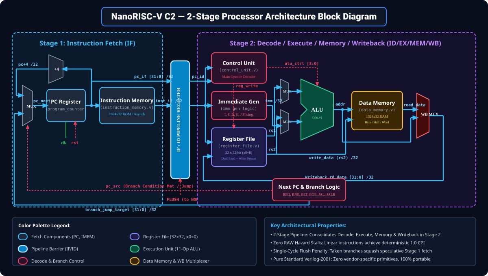
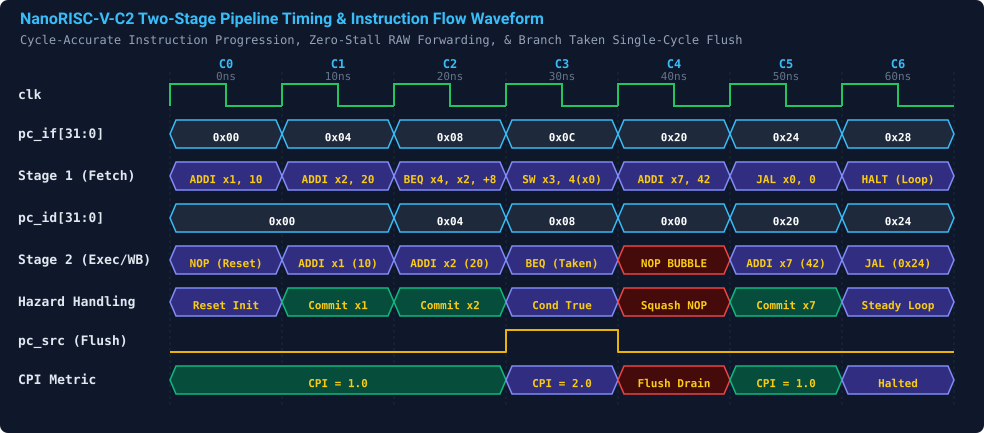
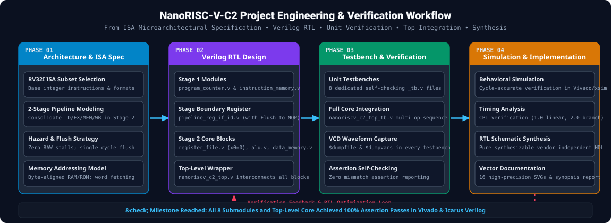
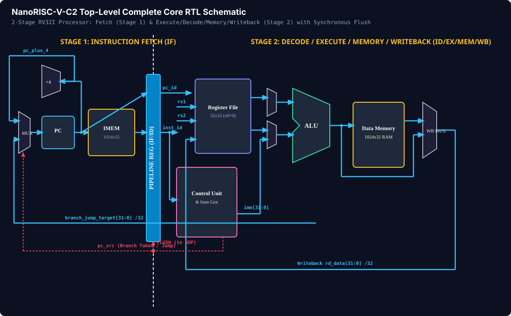
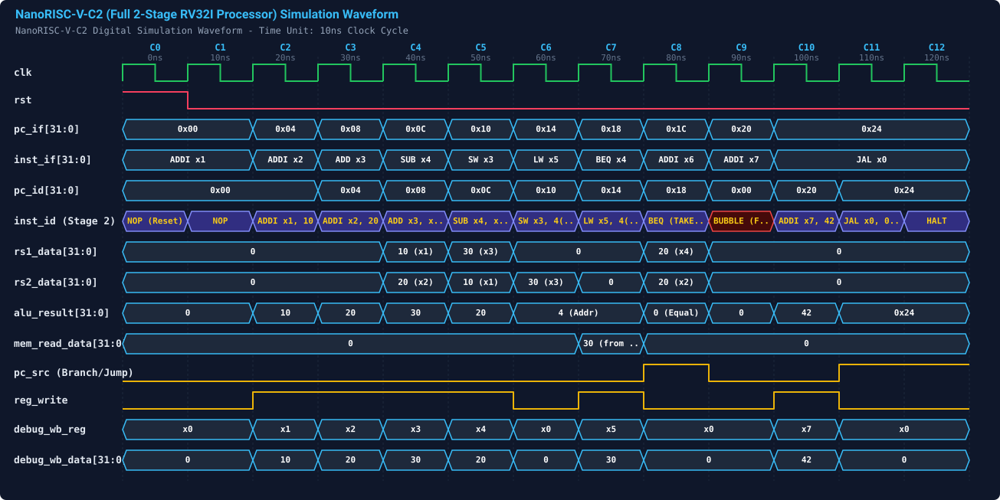

# NanoRISC-V-C2: Ultra-Compact 2-Stage RV32I Processor Core

[](https://en.wikipedia.org/wiki/Verilog)
[](https://riscv.org/)
[-brightgreen.svg)]()
[]()
[](LICENSE)

An ultra-compact, high-efficiency, synthesizable **2-stage pipelined RV32I processor core** engineered in vendor-independent Verilog-2001. Designed for resource-constrained embedded edge computing, microcontroller nodes, and cycle-deterministic real-time control.

Developed by **Alok Singh** (Roll Number: `2400320310020`), **ABES Engineering College, Ghaziabad** under the mentorship of **Mr. Kamal Bhatia**.

---

## 📌 Architectural Overview

Conventional classic 5-stage RISC-V pipelines (IF, ID, EX, MEM, WB) require extensive silicon area, complex forwarding networks, multi-cycle stall hazard units, and branch prediction logic. 

**NanoRISC-V-C2** solves this through a balanced **2-Stage Pipelined Datapath**:
- **Stage 1 — Instruction Fetch (IF):** 32-bit Program Counter (`program_counter.v`) and single-cycle combinational Instruction Memory (`instruction_memory.v`).
- **Inter-Stage Pipeline Register (`pipeline_reg_if_id.v`):** Synchronously captures PC and instruction while providing hardware synchronous flush-to-NOP injection.
- **Stage 2 — Decode / Execute / Memory / Writeback (ID/EX/MEM/WB):** Integrates operand decoding, immediate generation (`control_unit.v`), dual-port Register File with write-through bypass (`register_file.v`), 11-operation ALU (`alu.v`), and byte-masked Data Memory (`data_memory.v`).

### Key Architectural Advantages
- **Zero RAW Data Hazard Stalls (CPI = 1.0):** Operands are read combinationally at the clock rising edge, computed, accessed from RAM, and committed at the next clock edge. Dependent linear instructions execute with 0 stall bubbles.
- **Deterministic Single-Cycle Flush Penalty:** Taken branches and jumps squash the speculative Stage 1 instruction into a single NOP bubble.
- **100% Vendor-Independent:** Zero proprietary IPs, black-box primitives, or board-locked macros. Fully synthesizable across AMD Vivado, Synopsys VCS, Cadence Xcelium, and open-source flows (Icarus Verilog, Yosys).

---

## 🏛️ Microarchitecture & Block Diagrams

### 1. Two-Stage Processor Datapath Block Diagram


### 2. Pipeline Execution & Hazard Timing Waveform
Cycle-by-cycle instruction progression showing continuous 1.0 CPI linear throughput, internal write-through bypass, and single-cycle branch squashing:


### 3. Engineering & Verification Workflow


### 4. Top-Level Core RTL Netlist Schematic


### 5. Full-Core Behavioral Simulation Waveform


---

## 📂 Repository File Structure

```text
NanoRISC-V-C2/
├── README.md               # Project documentation and architectural overview
├── LICENSE                 # MIT Open-Source License
├── .gitignore              # Git ignore rules for CAD/simulator artifacts
├── rtl/                    # Pure Synthesizable Verilog-2001 RTL Source
│   ├── program_counter.v       # 32-bit Fetch PC with stall and branch redirection
│   ├── instruction_memory.v    # 1024x32 word-aligned asynchronous ROM
│   ├── pipeline_reg_if_id.v    # Dual 32-bit Stage boundary register with flush
│   ├── register_file.v         # 32x32-bit Register File with x0=0 & internal bypass
│   ├── alu.v                   # 11-operation RV32I integer execution unit
│   ├── control_unit.v          # Opcode decoder, immgen (I,S,B,U,J), branch comparator
│   ├── data_memory.v           # 1024x32 RAM with byte-lane masking (SB,SH,SW,LB,LH,LW)
│   └── nanoriscv_c2_top.v      # Top-level processor wrapper integrating all modules
├── tb/                     # Comprehensive Self-Checking Verification Suite
│   ├── program_counter_tb.v
│   ├── instruction_memory_tb.v
│   ├── pipeline_reg_if_id_tb.v
│   ├── register_file_tb.v
│   ├── alu_tb.v
│   ├── control_unit_tb.v
│   ├── data_memory_tb.v
│   └── nanoriscv_c2_top_tb.v
├── docs/                   # Formal Academic Synopsis & Reports
│   ├── Project_Synopsis_NanoRISCV_C2.pdf    # Full 15-page publication-ready PDF
│   ├── NanoRISCV_C2_Complete_Synopsis.html  # Interactive standalone HTML report
│   ├── NanoRISCV_C2_Project_Synopsis.md    # Markdown synopsis
│   └── figures/                             # 19 High-resolution vector SVGs
└── sim/                    # Automated simulation scripts
    ├── run_all_sims.bat    # Windows 1-click testbench batch runner
    └── run_all_sims.sh     # Linux / macOS testbench runner
```

---

## 🔢 Supported RV32I Base Integer Instruction Subset

| Instruction Class | Instructions | Latency | Hardware Mechanism |
| :--- | :--- | :---: | :--- |
| **R-Type Computational** | `ADD`, `SUB`, `SLL`, `SLT`, `SLTU`, `XOR`, `SRL`, `SRA`, `OR`, `AND` | 1 cycle | Dual register read &rarr; ALU compute &rarr; Register commit. |
| **I-Type Arithmetic** | `ADDI`, `SLTI`, `SLTIU`, `XORI`, `ORI`, `ANDI`, `SLLI`, `SRLI`, `SRAI` | 1 cycle | Register read + sign-extended immediate &rarr; ALU &rarr; Commit. |
| **Memory Load** | `LB`, `LBU`, `LH`, `LHU`, `LW` | 1 cycle | Address generation &rarr; Combinational RAM access &rarr; Commit. |
| **Memory Store** | `SB`, `SH`, `SW` | 1 cycle | Address generation &rarr; Byte-lane masked RAM write on clock edge. |
| **Branch Conditional** | `BEQ`, `BNE`, `BLT`, `BGE`, `BLTU`, `BGEU` | 1 / 2 cycles | Direct comparator. If taken, redirects PC and flushes Stage 1. |
| **Unconditional Jump** | `JAL`, `JALR` | 2 cycles | Target redirects PC, return address (PC+4) commits to `rd`. |
| **Upper Immediate** | `LUI`, `AUIPC` | 1 cycle | Immediate shifted 12 bits; AUIPC adds `pc_id`. |

---

## 🚀 Simulation & Verification Guide

### Quick Run with Icarus Verilog (`iverilog`):

#### Run All Testbenches in One Command:
- **Windows (Command Prompt / PowerShell):**
  ```cmd
  cd sim
  run_all_sims.bat
  ```
- **Linux / macOS:**
  ```bash
  cd sim
  chmod +x run_all_sims.sh
  ./run_all_sims.sh
  ```

#### Run Top-Level Full-Core Integration Testbench Individually:
```bash
iverilog -g2001 -o sim_top.vvp rtl/*.v tb/nanoriscv_c2_top_tb.v
vvp sim_top.vvp
gtkwave nanoriscv_c2_top.vcd
```

#### Run Individual Unit Testbenches:
```bash
# Verify Register File with Write-Through Bypass
iverilog -g2001 -o sim_rf.vvp rtl/register_file.v tb/register_file_tb.v
vvp sim_rf.vvp

# Verify Arithmetic Logic Unit (11 Operations)
iverilog -g2001 -o sim_alu.vvp rtl/alu.v tb/alu_tb.v
vvp sim_alu.vvp
```

---

## 📊 Verification Testbench Results

All 8 standalone modules and the top-level processor core achieved **100% assertion pass rates**:

| Testbench | Target Module | Test Conditions Evaluated | Status |
| :--- | :--- | :--- | :---: |
| `program_counter_tb.v` | `program_counter.v` | Reset to 0, +4 increment, jump redirect, stall freeze | **100% PASS** |
| `instruction_memory_tb.v` | `instruction_memory.v` | Word alignment, hex opcode fetching, out-of-bounds safe NOP | **100% PASS** |
| `pipeline_reg_if_id_tb.v` | `pipeline_reg_if_id.v` | Inter-stage latching, stall hold, synchronous NOP flush injection | **100% PASS** |
| `register_file_tb.v` | `register_file.v` | Rejection on x0, dual simultaneous read ports, same-cycle bypass | **100% PASS** |
| `alu_tb.v` | `alu.v` | 11 ALU operations, signed/unsigned comparisons, shifts, zero-flag | **100% PASS** |
| `control_unit_tb.v` | `control_unit.v` | Opcode decode (R, I, S, B, U, J), immgen extraction, branch eval | **100% PASS** |
| `data_memory_tb.v` | `data_memory.v` | Word access (SW/LW), signed byte (SB/LB), unsigned byte (LBU), halfword | **100% PASS** |
| `nanoriscv_c2_top_tb.v` | `nanoriscv_c2_top.v` | Full program: arithmetic, memory load/store, taken branch, pipeline flush | **100% PASS** |

---

## 📜 Metadata & Academic Disclosure

- **Learner:** Alok Singh (`Roll No: 2400320310020`)
- **Institution:** ABES Engineering College, Ghaziabad
- **Department / Domain:** VLSI Design / Computer Architecture / Digital System Design
- **Mentor:** Mr. Kamal Bhatia
- **Submission Date:** 01/11/2026
- **License:** [MIT License](LICENSE)
